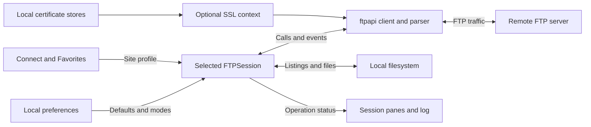
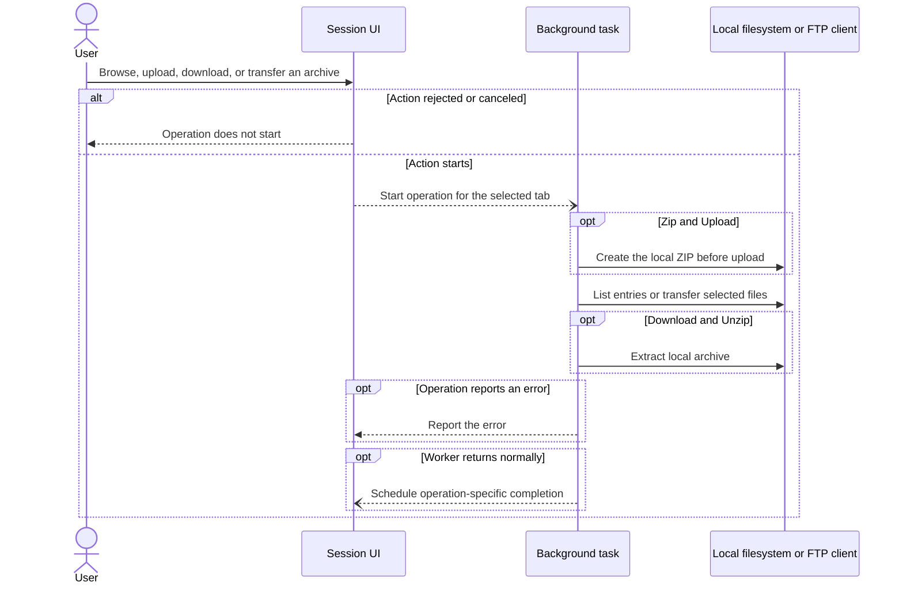
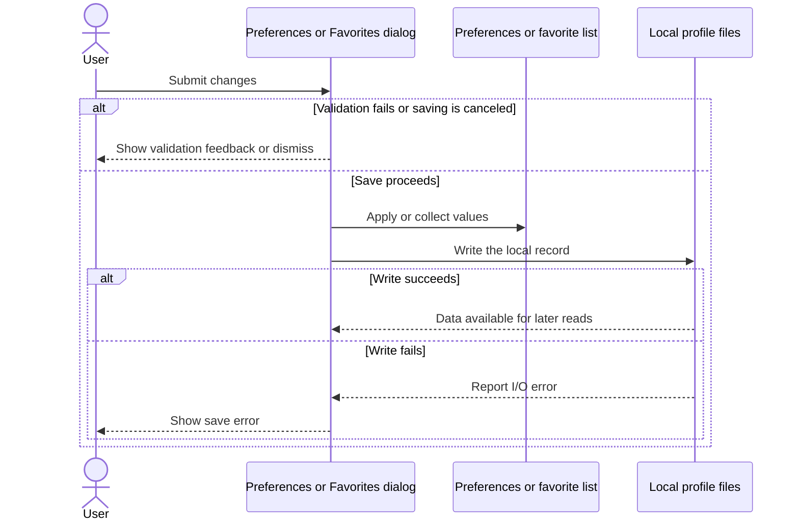

# ADR-000 — jFTP current architecture

- **Date** 2026-11-19
- **Status** Recorded as the current-state baseline
- **Source revision** `7b6cfe658bdca7074bccef0a6124f0a9eae80ebe`
- **Product behavior** [jFTP as-is PRD](../PRD.md)

## 1. Overview

jFTP is a single desktop application that browses and transfers files between a local filesystem and a user-selected FTP server. This ADR records the architecture visible in source and build configuration. Historical rationale and rejected alternatives are unknown. Consequences and review triggers are present-day analysis. Build, packaged startup, and server interoperability remain unverified.

## 2. Technology documentation references

| Technology | Reference | Relevance |
| --- | --- | --- |
| Java Swing | [Oracle Swing event dispatch thread](https://docs.oracle.com/javase/tutorial/uiswing/concurrency/dispatch.html) | UI event dispatch and worker boundaries |
| Java Object Serialization | [Oracle serialization specification](https://docs.oracle.com/en/java/javase/25/docs/specs/serialization/) | Local preferences and favorite records |
| Java Secure Socket Extension | [Oracle JSSE reference](https://docs.oracle.com/en/java/javase/25/security/java-secure-socket-extension-jsse-reference-guide.html) | SSL context, key managers, and trust managers |
| FTP and FTP over TLS | [RFC 959](https://www.rfc-editor.org/rfc/rfc959.html) · [RFC 4217](https://www.rfc-editor.org/rfc/rfc4217.html) | Protocol background and control/data boundaries |
| Java ZIP APIs | [Oracle ZIP package reference](https://docs.oracle.com/en/java/javase/25/docs/api/java.base/java/util/zip/package-summary.html) | Local archive creation and extraction |
| JavaHelp | [JavaHelp System User’s Guide](https://docs.oracle.com/cd/E19253-01/819-0913/819-0913.pdf) | Bundled help sets and map IDs |
| Maven Assembly | [Apache Maven assembly descriptor](https://maven.apache.org/plugins/maven-assembly-plugin/assembly.html) | Distribution layout and archives |
| `ftpapi` | [POM declaration](../../pom.xml#L71-L75) · [Observed calls](../../src/main/java/com/myjavaworld/jftp/FTPSession.java#L624-L673) | External FTP client and listing parser. Implementation documentation remains unverified. |

These references describe their respective technologies. The POM establishes the versions declared by jFTP.

## 3. System architecture and distribution

One Maven project packages the application. `JFTPApplication` applies the locale and look and feel, directly constructs and shows the main window, and opens the initial session tab. Background connection and transfer operations use a separate worker path that posts completion to the Swing event dispatch thread (EDT). [Desktop startup](../../src/main/java/com/myjavaworld/jftp/JFTPApplication.java#L32-L67) · [Worker completion](../../src/main/java/com/myjavaworld/gui/SwingWorker.java#L125-L155)

| Area | Current configuration |
| --- | --- |
| Code | `src/main/java` contains the Swing UI, session logic, actions, SSL integration, and ZIP helpers. |
| Resources | Maven includes three language-bundle roots, images, and JavaHelp. |
| Dependencies | The POM declares `ftpapi` 3.0.0, JavaHelp 2.0.05, and test-scoped JUnit 3.8.1. |
| Build and packaging | Maven declares Java source/target `1.5`, a manifest entry point with a `lib/` classpath prefix, and ZIP, directory, and TAR.GZ assemblies with dependencies under `lib/`. A working JDK/Maven combination remains to be demonstrated. |

[Dependencies and resources](../../pom.xml#L65-L100) · [Compiler and manifest](../../pom.xml#L102-L124) · [Assembly phase](../../pom.xml#L140-L155) · [Resource inventory](../jftp-zasoby.md)

The assembly descriptor puts the project JAR at the distribution root, while both launcher scripts refer to it under `lib/`. The effective archive and launcher outcome need verification. Reproducing the build also requires resolving dependencies declared against a historical repository. [Assembly file sets](../../src/main/assembly/binary.xml#L19-L43) · [Windows launcher](../../src/main/scripts/jftp.bat#L1) · [Shell launcher](../../src/main/scripts/jftp.sh#L1) · [Dependency repository](../../pom.xml#L41-L47)

## 4. Components and dependencies

| Component | Responsibility and dependencies |
| --- | --- |
| `JFTPApplication` and `JFTP` | Start and own the main window, tabs, menus, and shared preferences. Actions use the window to locate the selected session. |
| `FTPSession`, `SessionPanel`, and the local and remote panes | Hold tab-scoped navigation, filters, progress, and connection state. The session creates both panes, which retain a reference to it. The session calls back into the window for shared UI updates. |
| Application `SwingWorker` | Runs background work and posts completion to the EDT after normal return. |
| External `ftpapi` | Supplies transport, listings, and events. The session instantiates the client and parser using class names from the connection profile. |
| SSL, persistence, and archives | SSL creates the optional context and consults local certificate stores. Preferences and favorites use local storage. ZIP actions invoke archive helpers and session transfers. |

These are logical responsibilities inside one process. Direct references run both ways between the window, session, and panes. Proxy settings are process-wide through JVM SOCKS properties and the default authenticator. [Window and tabs](../../src/main/java/com/myjavaworld/jftp/JFTP.java#L119-L152) · [Session fields](../../src/main/java/com/myjavaworld/jftp/FTPSession.java#L70-L110) · [Pane creation](../../src/main/java/com/myjavaworld/jftp/FTPSession.java#L289-L312) · [Local pane](../../src/main/java/com/myjavaworld/jftp/LocalPane.java#L98-L113) · [Remote pane](../../src/main/java/com/myjavaworld/jftp/RemotePane.java#L90-L105) · [FTP and SSL setup](../../src/main/java/com/myjavaworld/jftp/FTPSession.java#L624-L641) · [Proxy settings](../../src/main/java/com/myjavaworld/jftp/JFTPUtil.java#L68-L94)

## 5. Data models and storage

| Model | Key data and lifetime |
| --- | --- |
| `RemoteHost` | Host, ports, credentials, client/parser class names, working directories, connection options, and commands. The session retains the active profile. |
| `Favorite` | Named `RemoteHost` subtype, persisted in `~/.jftp/data/favorites.ser`. The writer uses a sealed object when a cipher is available and a plain serialized list otherwise. Loading a legacy list attempts to save it again through the writer. Both forms must be handled as sensitive user data. |
| `JFTPPreferences` | Window, locale, transfer mode mapping, connection defaults, proxy, security, and update settings. Serialized to `~/.jftp/data/preferences.ser`. |
| Certificate stores | Separate client and server JKS stores, with paths and store passwords from preferences. The key and trust managers use these stores. |
| Tab and transfer state | The session holds current directories, selections and filters, active client, progress, and abort flag. File data resides at the selected local or remote destination. ZIP actions may create a local intermediate archive. |

[Base directory and preferences](../../src/main/java/com/myjavaworld/jftp/JFTP.java#L64-L75) · [Preference serialization](../../src/main/java/com/myjavaworld/jftp/JFTP.java#L512-L555) · [Host fields](../../src/main/java/com/myjavaworld/jftp/RemoteHost.java#L33-L52) · [Favorite subtype](../../src/main/java/com/myjavaworld/jftp/Favorite.java#L23-L33) · [Favorites read](../../src/main/java/com/myjavaworld/jftp/FavoritesManager.java#L48-L85) · [Favorites write](../../src/main/java/com/myjavaworld/jftp/FavoritesManager.java#L112-L135) · [JKS loading](../../src/main/java/com/myjavaworld/jftp/ssl/KeyStoreManager.java#L167-L188)

## 6. Interface contracts

| Boundary | Normal behavior | Errors and open points |
| --- | --- | --- |
| Connect action → session | Submits a profile, starts a worker, connects and logs in, runs configured commands, then requests a filtered listing. Completion applies data when the client remains connected. | The connect/login FTP error branch logs the error and attempts disconnect. Replacement schedules disconnect separately with no wait in the call path. |
| Session → `ftpapi` → server | Sends connection options, credentials, directory/file selections, and commands. Consumes listings, replies, and connection/transfer events. | Protocol negotiation, collision behavior, and partial outputs depend on the external library and server. |
| Trust manager → certificate warning | Checks certificate date, hostname, and trust. A warning delegates the continue/decline decision to the user. | Decline raises a certificate exception. Actual negotiation and data-channel protection require runtime evidence. |
| Settings/favorites → local storage | Valid settings update the shared model and are serialized. Favorite actions load or save the local list. | A failed preference write can leave changes in memory. The dialog shows the write error and closes. |
| Update worker → historical HTTP service | An enabled startup check fetches properties for the latest version and information URL, compares version strings, and can display a notice. | Exceptions are logged and retried after a delay. Service availability remains unknown. |

[Connect and listing](../../src/main/java/com/myjavaworld/jftp/FTPSession.java#L593-L698) · [Disconnect](../../src/main/java/com/myjavaworld/jftp/FTPSession.java#L1495-L1530) · [Trust decision](../../src/main/java/com/myjavaworld/jftp/ssl/JFTPTrustManager.java#L76-L96) · [Preference validation and write](../../src/main/java/com/myjavaworld/jftp/PreferencesDlg.java#L281-L335) · [Update startup](../../src/main/java/com/myjavaworld/jftp/JFTP.java#L155-L162) · [Update worker](../../src/main/java/com/myjavaworld/jftp/AutoUpdater.java#L32-L91)

## 7. Runtime configuration

The search of `src/main/java` and the packaged launcher scripts found no required application environment variables. Local state derives from the JVM `user.home` property. Preferences set application defaults and certificate paths. The selected site profile supplies FTP options. [Data directory](../../src/main/java/com/myjavaworld/jftp/JFTP.java#L64-L75) · [Launcher sources](../../src/main/scripts)

## 8. Recorded technical decisions

| Observed decision | Consequences | Review trigger |
| --- | --- | --- |
| One Swing process with per-tab session state and shared preferences | Independent working directories and selections coexist with direct UI coupling and process-wide proxy state. | A feature needs independent proxy settings or changes cross-tab behavior. |
| Profile-selected external FTP client and listing parser | Supports multiple shipped class mappings. Saved profiles and dependency availability constrain renames and replacements. | An FTP library or class mapping changes. |
| Sequential transfer batches with background work and EDT completion | The batch can stop before the next item after it observes Abort. In-flight cancellation and reconnect ordering still depend on separate work and external callbacks. | Transfers become parallel or cancellation/reconnect changes. |
| Local serialized settings and favorites with separate certificate stores | Data survives restarts. Format changes affect old profiles. The fallback favorites file can contain unencrypted credentials. | Changing serialization, credential storage, or trust stores. |
| Maven assembly with bundled help and translated resources | The package defines a desktop distribution boundary. Launcher correctness depends on the artifact layout matching the scripts and manifest. | Changing the JDK, dependencies, resource layout, or distribution format. |

## 9. Diagrams

The existing [system context and UML class diagrams](../architecture.md#system-context) cover the process and external server. The [connection sequence](../architecture.md#connection-sequence) shows login and its explicit error path. The [batch upload activity](../architecture.md#batch-upload-activity) shows the loop, abort checks, and remote refresh.

### Data flow

### Browsing and transfer sequence

This view groups related flows. Individual actions differ in their refresh behavior after errors. [Remote listing](../../src/main/java/com/myjavaworld/jftp/FTPSession.java#L400-L442) · [Upload completion](../../src/main/java/com/myjavaworld/jftp/FTPSession.java#L835-L875) · [Zip and Upload](../../src/main/java/com/myjavaworld/jftp/actions/ZipAndUploadAction.java#L59-L123) · [Download and Unzip](../../src/main/java/com/myjavaworld/jftp/actions/DownloadAndUnzipAction.java#L58-L113)

### Local settings and favorites sequence

[Preference validation and write](../../src/main/java/com/myjavaworld/jftp/PreferencesDlg.java#L281-L335) · [Favorite dialog save](../../src/main/java/com/myjavaworld/jftp/FavoritesDlg.java#L324-L343)

## 10. Verification and testing strategy

**Observed baseline.** The POM declares JUnit. The tracked test directories contain only placeholders. No build, automated suite, desktop session, or FTP service was exercised for this ADR. [Test dependency](../../pom.xml#L65-L70) · [Test sources](../../src/test/java) · [Test resources](../../src/test/resources)

**Future changes.** Apply repository TDD and Manual QA to the area being changed. Establish existing behavior first where the source leaves outcomes open. [Repository workflow](../../AGENTS.md)

| Layer | Scope |
| --- | --- |
| Unit | Characterize validation, transfer-mode selection, filename/date filters, and ZIP helpers with synthetic inputs. |
| Integration | Exercise profile persistence and legacy format handling in an isolated home. Use a controlled FTP/FTPS server for listing, authentication, and transfer contracts. |
| End-to-end and Manual QA | Launch the real app with synthetic state and a real test server. Exercise success, refusal, and abort. Inspect file results, UI responsiveness, logs, and persistence after restart. For packaging changes, start the extracted package outside the IDE. |

- **TAC-01 — Packaging.** Record the build JDK, Maven, and resolved dependencies. Confirm that the extracted package starts in a disconnected tab and exposes translations and help.
- **TAC-02 — Session transitions.** With two connected tabs, reconnect one and verify the other retains its directory and listing. Characterize whether overlapping disconnect and connect actions alter the selected tab’s final state.
- **TAC-03 — Transfer and abort.** In binary mode, verify uploaded and downloaded bytes and destination refresh against known files. When the batch observes Abort before its next item, verify that item never starts. Record the in-flight file outcome separately.
- **TAC-04 — Local data.** Save preferences and favorites in an isolated home and verify they reload after restart. Before changing formats, characterize legacy list reads and the behavior on unreadable files.
- **TAC-05 — Certificate handling.** Trigger a warning with a controlled certificate, decline it, and verify that the tab does not become usable for remote operations. Record control- and data-channel behavior separately for each mode under review.
