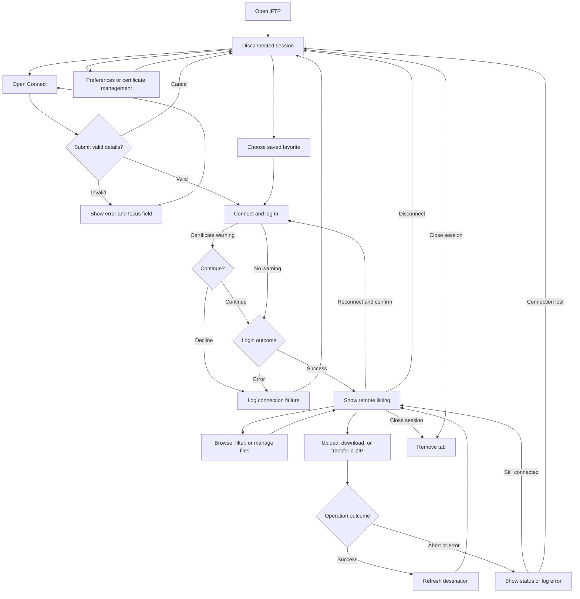

# PRD — jFTP as it exists today

## 1. Executive Summary

jFTP is an existing desktop application for transferring files between a local computer and an FTP server. It brings browsing, transfers, saved connections, and operation status into a tabbed workspace. This baseline describes behavior supported by the repository at revision `f0943f3138f60bb9a15f352f3cb09f2aecacaa56`, based on static review of source, interface text, and bundled help. Runtime behavior remains unverified.

## 2. Problem Statement

A person exchanging files with an FTP server needs to locate items on both sides, choose the correct destination, and see what happened when a transfer succeeds, fails, or is interrupted. Repeated transfers add the work of re-entering connection details, returning to the right directories, and selecting the same types of files.

## 3. Users / Personas

These are task-based roles inferred from the available workflows. Actual user groups, frequency of use, and business priorities are unknown.

| Role | Goal | Expected outcome |
| --- | --- | --- |
| Occasional file sender or recipient | Connect to a known FTP site and move selected files | The files appear in the intended destination and the operation outcome is visible |
| Repeat transfer operator | Reopen saved sites, navigate to working directories, and move several items | Reusable connection profiles, independent tabs, and predictable selection rules |
| Operator managing a secured connection | Review a certificate warning and manage certificates | Enough detail to decide whether to continue or decline the connection |

## 4. Main Flows

### 4.1 Open, connect, reconnect, and close a session

1. The application opens a selected **Not Connected** tab. The user can open another tab or switch between tabs.
2. The user selects **Connect**, enters the host, port, username, and password, and can add an account name, connection options, starting directories, and commands to run after login.
3. If a required value is missing or a port fails validation, jFTP displays an error and focuses the relevant field. Canceling closes the dialog without submitting a connection.
4. After submission, the tab shows a connection status. If a certificate warning is triggered, the user can inspect the certificate and choose whether to continue. Declining rejects the certificate and interrupts the connection attempt.
5. After login, jFTP runs configured post-login commands and loads the remote listing from the configured remote directory, if supplied. The application also applies the configured local starting directory. Connection or login errors appear in the log. A failed login closes that connection attempt.
6. **Reconnect** reuses the tab's previous host details. If the tab is still connected, jFTP asks for confirmation before replacing the connection. **Disconnect** clears the remote listing and leaves the tab open. **Close Session** closes the selected tab.

[Startup and initial tab](../src/main/java/com/myjavaworld/jftp/JFTPApplication.java#L55) · [Connection form validation](../src/main/java/com/myjavaworld/jftp/ConnectionDlg.java#L673) · [Connection and reconnect](../src/main/java/com/myjavaworld/jftp/FTPSession.java#L593) · [Certificate decision](../src/main/java/com/myjavaworld/jftp/ssl/JFTPTrustManager.java#L76) · [Disconnect](../src/main/java/com/myjavaworld/jftp/FTPSession.java#L1495) · [Close session](../src/main/java/com/myjavaworld/jftp/JFTP.java#L188)

### 4.2 Browse, filter, and manage files

1. The user browses the local and remote panes and selects files or directories. Remote operations depend on the connected tab and its current selection.
2. The user can set or clear a filter independently for each pane. The dialogs offer inclusion or exclusion, a filename pattern with a case-sensitivity option, and a date range. The local filter also supports a hidden-file criterion. An invalid pattern or date is reported in the filter dialog.
3. Users can create files and directories, rename items, view properties, and delete selected items. Deletion requires confirmation. Available actions depend on the selection, connection, and desktop capabilities. The connected user can also submit FTP commands and see the replies in the log.

[Local and remote panels](../src/main/java/com/myjavaworld/jftp/FTPSession.java#L289) · [Local filter](../src/main/java/com/myjavaworld/jftp/LocalFileFilterDlg.java#L102) · [Remote filter and validation](../src/main/java/com/myjavaworld/jftp/RemoteFileFilterDlg.java#L129) · [Remote and local deletion](../src/main/java/com/myjavaworld/jftp/FTPSession.java#L1206) · [Local file actions](../src/main/java/com/myjavaworld/jftp/LocalSystemMenu.java#L271) · [Remote properties and permissions](../src/main/java/com/myjavaworld/jftp/JFTP.java#L325) · [Command submission](../src/main/java/com/myjavaworld/jftp/FTPSession.java#L1420)

### 4.3 Upload, download, and handle an interruption

1. In a connected tab, the user selects local items to upload to the current remote directory, or remote items to download to the current local directory. The FTP menu enables the standard transfer commands when the corresponding pane has a selection.
2. Standard transfers accept multiple selected items and traverse selected directories. Directory traversal uses the filter from the source pane. For a single selected item, **Upload As** or **Download As** lets the user supply a destination name.
3. The status bar shows the current operation and transfer progress, elapsed time, and speed when available. The log shows messages and errors. When normal transfer work finishes, jFTP refreshes the destination pane.
4. The user can request **Abort**. A reported abort resets progress, writes an abort message to the log, and stops the normal batch from starting subsequent items. Partial files and same-name collision outcomes require separate verification.

[Transfer availability](../src/main/java/com/myjavaworld/jftp/FTPMenu.java#L224) · [Download and recursive filtering](../src/main/java/com/myjavaworld/jftp/FTPSession.java#L707) · [Upload and recursive filtering](../src/main/java/com/myjavaworld/jftp/FTPSession.java#L835) · [Progress display](../src/main/java/com/myjavaworld/jftp/StatusBar.java#L61) · [Abort control](../src/main/java/com/myjavaworld/jftp/actions/AbortAction.java#L53) · [Abort feedback](../src/main/java/com/myjavaworld/jftp/FTPSession.java#L560)

### 4.4 Transfer a ZIP archive

1. For **Zip and Upload**, the user selects local items, chooses an archive name and location, and confirms. jFTP creates a ZIP from the selection and uploads that archive to the current remote directory.
2. For **Download and Unzip**, the user selects one eligible remote ZIP and chooses where to download and extract it. jFTP downloads the archive and extracts it to the selected local destination.
3. Canceling the options dialog leaves the action unsubmitted. The operation reports errors through the session. Cleanup and recovery after an interrupted archive operation remain open questions.

[ZIP action availability](../src/main/java/com/myjavaworld/jftp/FTPMenu.java#L235) · [Zip and Upload](../src/main/java/com/myjavaworld/jftp/actions/ZipAndUploadAction.java#L59) · [Download and Unzip](../src/main/java/com/myjavaworld/jftp/actions/DownloadAndUnzipAction.java#L58)

### 4.5 Reuse a site and manage application settings

1. In **Favorites**, users can add, edit, delete, or connect to a saved site. A selected favorite uses the current tab. If no tab exists, jFTP creates one. The user can also save a connected site as a favorite. Duplicate names in that flow produce an error.
2. In **Preferences**, the user can review and save regional and interface settings, transfer modes, connection defaults, proxy, security, and update options. **Cancel** closes the dialog without applying the pending edits. Saving runs field validation before applying changes.
3. Through **Tools** and **Help**, the user can manage client and server certificates, check for updates, or open bundled help. The settings and favorites persist across launches when saved successfully. Availability of the historical update service is unknown.

[Favorite management and connection](../src/main/java/com/myjavaworld/jftp/FavoritesDlg.java#L167) · [Save a connected site](../src/main/java/com/myjavaworld/jftp/JFTP.java#L411) · [Favorites persistence](../src/main/java/com/myjavaworld/jftp/FavoritesManager.java#L112) · [Preferences](../src/main/java/com/myjavaworld/jftp/PreferencesDlg.java#L209) · [Save preferences](../src/main/java/com/myjavaworld/jftp/PreferencesDlg.java#L281) · [Certificate management](../src/main/java/com/myjavaworld/jftp/ssl/CertificateManagerDlg.java#L104) · [Help menu](../src/main/java/com/myjavaworld/jftp/HelpMenu.java#L61)

## 5. User Stories

- As a file sender, I want to select local files and upload them to the directory shown in the remote pane, so that I can put them in the intended location.
- As a file recipient, I want to see connection errors in the session, so that I can diagnose a failed attempt and retry.
- As a repeat transfer operator, I want to open a saved site in a tab, so that I can reuse its connection details.
- As an operator with multiple open sites, I want to switch tabs and disconnect one site without closing the other tabs, so that I can keep my other work open.
- As a user of a secured connection, I want to inspect a certificate warning and decline the connection, so that I can stop before proceeding with a certificate I do not accept.
- As an operator transferring several items, I want to abort the operation and see that it stopped, so that I can inspect the result before retrying.

## 6. Acceptance Criteria

These criteria describe the as-is baseline and inherit the source evidence in the referenced flow sections.

### Sessions and connections ([flow 4.1](#41-open-connect-reconnect-and-close-a-session))

- **AC-01** After startup, the selected session tab is labeled **Not Connected** in the English interface.
- **AC-02** Submitting Connect with a blank hostname keeps the form open and focuses the hostname field.
- **AC-03** Successful login to a reachable server with a readable starting directory populates the remote pane with that directory's listing.
- **AC-04** Reconnecting an already connected tab presents a confirmation before disconnecting the existing connection.
- **AC-05** Disconnecting a connected tab clears its remote listing while leaving the tab open.
- **AC-06** Declining a displayed certificate warning rejects the certificate for that connection attempt.

### Files and transfers ([flows 4.2–4.4](#42-browse-filter-and-manage-files))

- **AC-07** A malformed filename pattern triggers a validation error in the filter dialog.
- **AC-08** Declining the deletion confirmation leaves the selected items untouched by that delete action.
- **AC-09** The FTP menu enables **Download As** only when the tab is connected and exactly one remote item is selected.
- **AC-10** A completed standard download refreshes the local listing using the current local filter.
- **AC-11** When jFTP receives a transfer-aborted event, the session log records the abort.
- **AC-12** An approved **Zip and Upload** operation creates the archive before starting its upload.

### Saved profiles and preferences ([flow 4.5](#45-reuse-a-site-and-manage-application-settings))

- **AC-13** Connecting from the Favorites manager with no existing session creates a session tab for that connection attempt.
- **AC-14** Attempting to save a connected site under an existing favorite name shows a duplicate-name error.
- **AC-15** Saving valid preferences writes the changed settings for subsequent launches.

## 7. Out of Scope

- **Modernization and new features.** This baseline describes the current desktop application. Future UX, protocol additions, and migration decisions require a separate specification.
- **Runtime and compatibility certification.** Platform support, server interoperability, cryptographic guarantees, and file-size limits need separate verification.
- **Service ownership and usage.** FTP server administration, the historical update service, audience demographics, usage metrics, and commercial policy are outside the available evidence.

## 8. Constraints

### Business

Users need a reachable FTP server and credentials accepted by that server. Remote file actions depend on permissions granted by the server. The repository provides no evidence for service levels or actual usage volume.

### Functional

- The connection form requires nonblank host, username, and password values. Its numeric port check accepts `0` through `65535`, including `0` at form level. That validation provides no assurance the server accepts the port. The implicit SSL port receives its own check when implicit mode is selected. [Connection validation](../src/main/java/com/myjavaworld/jftp/ConnectionDlg.java#L673)
- The interface offers plain FTP, explicit or implicit SSL, and an option to use SSL if available. Actual negotiation and server compatibility depend on the server and the running environment. [Connection options](../src/main/resources/com/myjavaworld/jftp/ConnectionDlg.properties#L15)
- Transfer modes include ASCII, binary, and automatic selection by extension with a default for unmatched extensions. [Transfer-mode controls](../src/main/java/com/myjavaworld/jftp/TransferModeMenu.java#L58) · [Automatic selection](../src/main/java/com/myjavaworld/jftp/FTPSession.java#L224)
- The repository contains interface text in English, German, and Traditional Chinese (`zh_TW`). The regional preference lists additional locale choices. Translation coverage for other locales has not been established. [Locale selection](../src/main/java/com/myjavaworld/jftp/LocalePrefsPanel.java#L108) · [Localization inventory](jftp-zasoby.md#indeks-pakietów-językowych)

## 9. UI Description

| Screen | Layout and controls | States and feedback |
| --- | --- | --- |
| Main window and session workspace | Menu and toolbar, session tabs, log, side-by-side local and remote file panes, and a status bar | A new tab is disconnected. A connected tab shows its remote listing and enables applicable actions. Connecting and transfer work display status. Errors and abort messages appear in the log. |
| Connect | General, Security, Advanced, and Commands tabs with Connect and Cancel controls | Invalid fields show an error and receive focus. Cancel returns to the workspace without submitting. |
| File operation dialogs | Controls for filters, file properties, alternate names, and archive destinations, depending on the selected action | Invalid options are reported in the dialog. Deletion prompts for confirmation before it proceeds. |
| Favorites | List of saved sites with Connect, Add, Edit, and Delete actions | Connect requires a selected profile. Editing or deleting applies to saved entries. The connected-site save flow reports duplicate names. |
| Preferences | Category selector, settings panel, and controls to save, cancel, or load defaults into the form | Invalid fields block saving. Preferences affect areas such as transfer modes and regional settings. |
| Certificate warning and certificates manager | Warning with certificate details and a continue/decline choice. The manager offers separate client and server certificate lists. | A declined warning stops that connection attempt. The manager offers viewing, importing, and deleting certificates. |

[Main window controls](../src/main/help/helpset/content/userInterface/mainWindow.html) · [Session layout](../src/main/java/com/myjavaworld/jftp/FTPSession.java#L289) · [Connect tabs](../src/main/resources/com/myjavaworld/jftp/ConnectionDlg.properties#L1) · [Preferences controls](../src/main/java/com/myjavaworld/jftp/PreferencesDlg.java#L93) · [Certificate warning controls](../src/main/java/com/myjavaworld/jftp/ssl/SecurityWarningDlg.java#L229)

## 10. User Flow Diagram

## 12. Further Notes

- Confirm which flows are actively used and which differences from bundled help are known defects. Source and help establish the available UI paths, while production use remains unknown.
- Verify same-name collisions, partial files, archive cleanup after interruption, and server-specific permission changes on a representative server before making commitments about those behaviors.
- Confirm which operating systems and server configurations can run this revision. The documentation includes desktop-dependent actions and historical service links. Their present availability is open.
