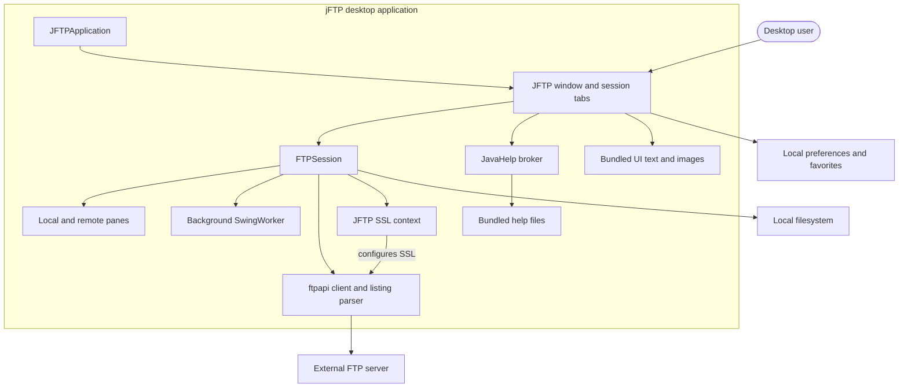
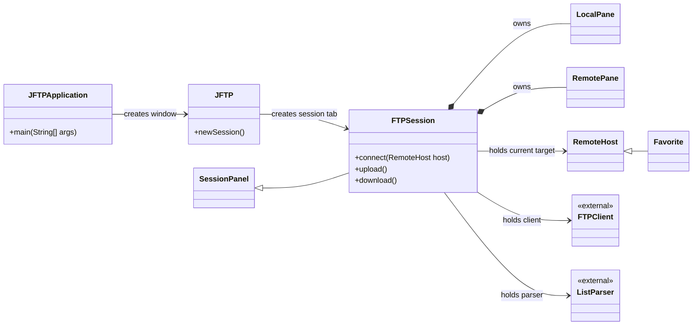
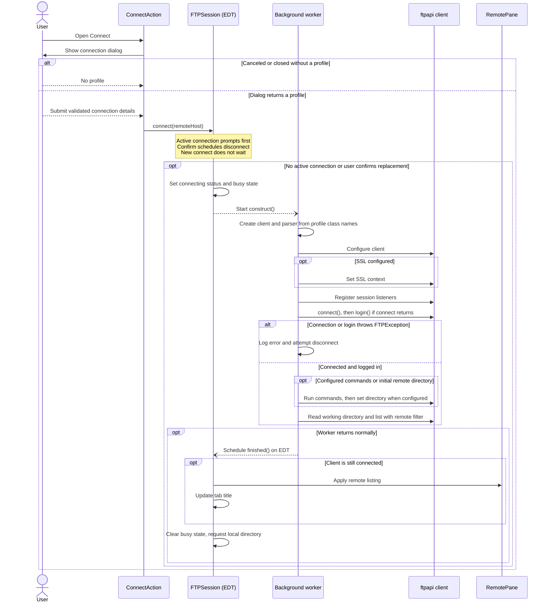
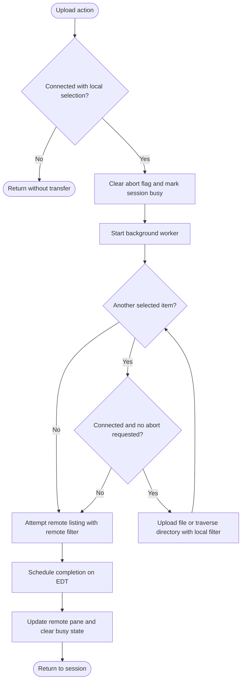

# jFTP architecture

These views describe the packaged desktop entry point and standard FTP session at source revision `cb2bde65209bd5c103422d26277f6af9f9928b30`. Arrows in the context view show dependencies. The sequence view shows call order and marks the background worker and Swing event dispatch thread (EDT) boundary.

## System context

<!-- SHA-256 normalized Mermaid: d0a6ae93280fed4a188ce31d73fa6dc6b05cac030335b03a7c46c0a89c6082ae, PNG: 3c7b6eebbb1ddaa23b200fc7e1b7e351d16fd10b6a5704b8eab7d8218674d65a -->

[Mermaid source](diagrams/system-context.mmd) · [PNG](diagrams/system-context.png)

The Maven manifest names `JFTPApplication` as the entry point. The launcher applies the stored locale and look and feel, constructs the window, shows it, and calls `jftp.newSession()`. The main window creates and selects an `FTPSession` tab. [Manifest and runtime dependencies](../pom.xml#L71-L80) · [Manifest entry point](../pom.xml#L112-L124) · [Desktop startup](../src/main/java/com/myjavaworld/jftp/JFTPApplication.java#L32-L67) · [Window and tab creation](../src/main/java/com/myjavaworld/jftp/JFTP.java#L123-L152)

The session builds the local pane, remote pane, and status log. Local listing uses the filesystem. Remote operations pass through the separately declared `ftpapi` dependency. The session configures `setSSLContext(...)` when the selected SSL mode calls for it. The window loads interface strings and images from classpath resources, exposes bundled JavaHelp through its menu, and uses local serialized files for preferences and favorites. [Session layout](../src/main/java/com/myjavaworld/jftp/FTPSession.java#L289-L312) · [Local directory listing](../src/main/java/com/myjavaworld/jftp/FTPSession.java#L338-L370) · [Client and SSL configuration](../src/main/java/com/myjavaworld/jftp/FTPSession.java#L624-L641) · [Bundled resources](../pom.xml#L83-L100) · [Help from the menu](../src/main/java/com/myjavaworld/jftp/HelpMenu.java#L61-L92) · [Help broker](../src/main/java/com/myjavaworld/jftp/JFTPHelp2.java#L40-L50) · [Preferences](../src/main/java/com/myjavaworld/jftp/JFTP.java#L512-L551) · [Favorites](../src/main/java/com/myjavaworld/jftp/FavoritesManager.java#L112-L133)

The context view groups toolkit and resource details. The [resource map](jftp-zasoby.md) expands build, localization, help, and packaging relationships.

## Core classes

<!-- SHA-256 normalized Mermaid: 402714d7ef4c2bb2ec72081c5012cb3a5ad6c2aeaff38b29dc9feee7f84f67e0, PNG: 4e7e1e916dd299ec387cf9a60fb4a70a70392c79800058a1d61f75dc038c92a2 -->

[Mermaid source](diagrams/core-classes.mmd) · [PNG](diagrams/core-classes.png)

`FTPSession extends SessionPanel` and creates both panes for its tab. It holds the current `RemoteHost` and references to the external `FTPClient` and `ListParser`. `Favorite extends RemoteHost`, which lets a selected favorite be used as a target profile. The diagram omits secondary widgets, listeners, and inherited toolkit types. [Session fields and inheritance](../src/main/java/com/myjavaworld/jftp/FTPSession.java#L70-L97) · [Pane construction](../src/main/java/com/myjavaworld/jftp/FTPSession.java#L289-L307) · [Favorite inheritance](../src/main/java/com/myjavaworld/jftp/Favorite.java#L23-L33) · [Favorite connection](../src/main/java/com/myjavaworld/jftp/FavoritesDlg.java#L232-L250)

## Connection sequence

<!-- SHA-256 normalized Mermaid: cb2a29c3d090a7410280ac5218c9ef80053a370bf80500ddb9aeca2f93884a43, PNG: c37757d335dd881f0ef764d94f1bddfcec5a683baf91d1077d40ee422ee2309e -->

[Mermaid source](diagrams/connect-sequence.mmd) · [PNG](diagrams/connect-sequence.png)

This view follows the Connect action in an existing tab. The action calls `session.connect(remoteHost)` only when the dialog returns a profile. The session worker uses `Class.forName(...)` for the profile's client and parser classes. After connect and login, it runs configured commands, applies the optional remote directory, and retrieves the listing. The worker posts `finished()` via `SwingUtilities.invokeLater(doFinished)` after its work returns normally. In that callback, a connected client allows the remote UI update. The callback also clears busy state and requests the initial local directory, which has its own validation and background listing. [Dialog and action](../src/main/java/com/myjavaworld/jftp/actions/ConnectAction.java#L51-L75) · [Worker and login](../src/main/java/com/myjavaworld/jftp/FTPSession.java#L593-L658) · [Listing and completion](../src/main/java/com/myjavaworld/jftp/FTPSession.java#L659-L698) · [Worker thread and EDT dispatch](../src/main/java/com/myjavaworld/gui/SwingWorker.java#L125-L155) · [Local directory validation](../src/main/java/com/myjavaworld/jftp/FTPSession.java#L338-L370)

The shown error branch covers the explicit `FTPException` handler around connect and login. Other connection and listing exceptions have separate handlers in the session. Replacing an active connection schedules `disconnect()` on its own worker. The source does not establish that this worker finishes before the new connection starts. Protocol internals and exact callback timing are outside the inspected source. [Replace confirmation](../src/main/java/com/myjavaworld/jftp/FTPSession.java#L593-L617) · [Asynchronous disconnect](../src/main/java/com/myjavaworld/jftp/FTPSession.java#L1495-L1530)

## Batch upload activity

<!-- SHA-256 normalized Mermaid: da9b90512422011b8204449a45a8ea22eddeccee7de761d73dc92fff3a9dc7b0, PNG: 74977b893f59b8002e99d30fe3cee94f60d15585690a181421df94bbfaccc693 -->

[Mermaid source](diagrams/batch-upload.mmd) · [PNG](diagrams/batch-upload.png)

Standard upload takes the current local selection and processes it in order in one worker. The loop checks `!client.isConnected() || abort` before starting each selected item. Directory traversal uses the local filter and rechecks connection and abort state on recursive entry. After the loop, the worker attempts a remote listing, then posts completion to update the pane and clear busy state. [Upload loop and completion](../src/main/java/com/myjavaworld/jftp/FTPSession.java#L835-L875) · [Recursive upload](../src/main/java/com/myjavaworld/jftp/FTPSession.java#L884-L940)

The Abort action sets the session flag and invokes `client.abort()` on a separate worker. The activity shows control flow around the batch. It leaves in-flight cancellation timing and partial-file behavior open because those depend on the external FTP implementation. Single-item alternate-name and ZIP workflows are covered at the product level in the [PRD](PRD.md). [Abort action](../src/main/java/com/myjavaworld/jftp/actions/AbortAction.java#L53-L79)

## Verification

Source links above refer to the inspected revision. The four standalone files were parsed with `mermaid.parse(source)` and rendered with `mermaid.render(id, source)` using Mermaid 11.12.0 in headless Chrome 157.0.8103.79. The PNGs were visually reviewed. The embedded sources match the standalone files. The target Markdown viewer may use a different Mermaid version. Application execution was outside this documentation review.
