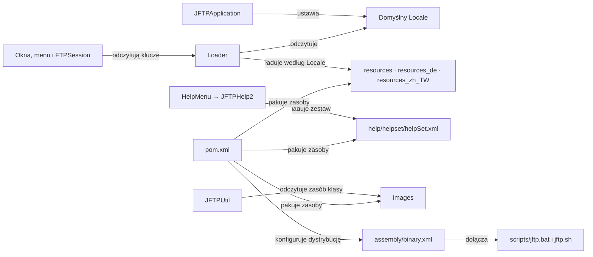

# Mapa zasobów i pakowania jFTP

Zasoby są potrzebne do analizy uruchamiania, interfejsu, lokalizacji i dystrybucji. Zacznij od [RepoMapy Javy](jftp-repo-map.rust.md), a gdy pytanie przechodzi przez granicę kodu i zasobów, użyj poniższych powiązań oraz [pełnego Repomixa zasobów](Repomix/jftp-repomix.resources.xml).

## Co zawierają `.properties`

- Teksty okien, menu, przycisków i podpowiedzi, w tym wspólne etykiety oraz komunikaty błędów. Przykładowo etykiety hosta, portu i trybu SSL są w `ConnectionDlg.properties`. Wartość portu pochodzi z kontrolki, a klasy klienta FTP i parsera są wybierane w kodzie i przekazywane przez `RemoteHost`. [Etykiety połączenia](../src/main/resources/com/myjavaworld/jftp/ConnectionDlg.properties#L6) · [Przypisanie parametrów](../src/main/java/com/myjavaworld/jftp/ConnectionDlg.java#L612) · [Inicjalizacja klienta i parsera](../src/main/java/com/myjavaworld/jftp/FTPSession.java#L624)
- Szablony statusu, potwierdzeń i ostrzeżeń zawierają argumenty takie jak `{0}` i `{1}`, kontynuacje wierszy, sekwencje `\n`, a miejscami treść HTML. `FTPSession` tworzy `MessageFormat` dla statusu połączenia, a `SecurityWarningDlg` wybiera tekst stosownie do wyniku sprawdzeń certyfikatu. [Szablony sesji](../src/main/resources/com/myjavaworld/jftp/FTPSession.properties#L1) · [Formatowanie w kodzie](../src/main/java/com/myjavaworld/jftp/FTPSession.java#L117) · [Ostrzeżenia certyfikatu](../src/main/java/com/myjavaworld/jftp/ssl/SecurityWarningDlg.java#L135)
- Klucze `mnemonic` i `mnemonicIndex` dostarczają znaki skrótów i pozycje podkreślenia w menu. `MMenu` i `MMenuItem` interpretują indeks jako liczbę. Zmiana etykiety może więc wymagać zmiany indeksu. [Dane menu pomocy](../src/main/resources/com/myjavaworld/jftp/HelpMenu.properties#L11) · [Interpretacja w kodzie](../src/main/java/com/myjavaworld/gui/MMenu.java#L64)

| Katalog | Pliki | Klucze |
| --- | ---: | ---: |
| `src/main/resources` | 57 | 610 |
| `src/main/resources_de` | 57 | 610 |
| `src/main/resources_zh_TW` | 58 | 616 |

W 57 wspólnych pakietach oba tłumaczenia mają te same zestawy kluczy co wariant bazowy. `zh_TW` ma dodatkowy [`InstallLicenseDlg_zh_TW.properties`](../src/main/resources_zh_TW/com/myjavaworld/jftp/InstallLicenseDlg_zh_TW.properties). W 41 niemieckich plikach są bajty spoza UTF‑8, odczytane jako ISO‑8859‑1. Repomix przechowuje ich treść w UTF‑8, zgodnie z formatem XML. Przy zmianach lokalizacji zachowaj znaczenie argumentów szablonów i sprawdź skróty na etykietach danego języka.

## Powiązania kodu i pakowania

- `JFTPApplication` ustawia domyślny język z preferencji. `ResourceLoader` używa tego języka przy pobieraniu pakietu, a jego ścieżka obsługi braku pakietu może zakończyć proces. [Wybór języka](../src/main/java/com/myjavaworld/jftp/JFTPApplication.java#L39) · [Obsługa brakującego pakietu](../src/main/java/com/myjavaworld/util/ResourceLoader.java#L31)
- Maven deklaruje pięć katalogów zasobów, wersję źródeł i celu kompilatora `1.5`, punkt startowy `JFTPApplication` i zależności `ftpapi` oraz `javahelp`. Deskryptor dystrybucji dołącza biblioteki i skrypty startowe. To zapis bieżącej konfiguracji projektu. [Zależności i zasoby](../pom.xml#L65) · [Kompilator i manifest](../pom.xml#L103) · [Pakowanie dystrybucji](../src/main/assembly/binary.xml#L13)
- `HelpMenu` wiąże pozycje menu z identyfikatorami JavaHelp. `JFTPHelp2` wyszukuje zestaw pomocy, a `JFTPUtil` ładuje obrazy z zasobów klas. Inwentarz Git zawiera 48 obrazów w katalogu pomocy i 50 w katalogu obrazów. [Wiązanie menu](../src/main/java/com/myjavaworld/jftp/HelpMenu.java#L63) · [Odczyt zestawu pomocy](../src/main/java/com/myjavaworld/jftp/JFTPHelp2.java#L40) · [Odczyt obrazów](../src/main/java/com/myjavaworld/jftp/JFTPUtil.java#L35)

## Indeks pakietów językowych

Indeks wiąże ścieżki wszystkich 172 plików `.properties` z miejscami, w których kod Javy przekazuje dosłowną nazwę do `getBundle`. Kreska oznacza brak takiego dopasowania w `src/main/java`. Użycia pośrednie i nazwy budowane dynamicznie wymagają dodatkowej analizy.

| Pakiet | Bazowy | Niemiecki | `zh_TW` | Odczyt nazwy w Javie |
| --- | --- | --- | --- | --- |
| `com.myjavaworld.gui.EditPopupMenu` | [plik](../src/main/resources/com/myjavaworld/gui/EditPopupMenu.properties) | [de](../src/main/resources_de/com/myjavaworld/gui/EditPopupMenu_de.properties) | [zh_TW](../src/main/resources_zh_TW/com/myjavaworld/gui/EditPopupMenu_zh_TW.properties) | [EditPopupMenu:36](../src/main/java/com/myjavaworld/gui/EditPopupMenu.java#L36) |
| `com.myjavaworld.gui.LicenseAgreementDlg` | [plik](../src/main/resources/com/myjavaworld/gui/LicenseAgreementDlg.properties) | [de](../src/main/resources_de/com/myjavaworld/gui/LicenseAgreementDlg_de.properties) | [zh_TW](../src/main/resources_zh_TW/com/myjavaworld/gui/LicenseAgreementDlg_zh_TW.properties) | [LicenseAgreementDlg:46](../src/main/java/com/myjavaworld/gui/LicenseAgreementDlg.java#L46) |
| `com.myjavaworld.gui.ProgressDialog` | [plik](../src/main/resources/com/myjavaworld/gui/ProgressDialog.properties) | [de](../src/main/resources_de/com/myjavaworld/gui/ProgressDialog_de.properties) | [zh_TW](../src/main/resources_zh_TW/com/myjavaworld/gui/ProgressDialog_zh_TW.properties) | [ProgressDialog:38](../src/main/java/com/myjavaworld/gui/ProgressDialog.java#L38) |
| `com.myjavaworld.jftp.AboutDlg` | [plik](../src/main/resources/com/myjavaworld/jftp/AboutDlg.properties) | [de](../src/main/resources_de/com/myjavaworld/jftp/AboutDlg_de.properties) | [zh_TW](../src/main/resources_zh_TW/com/myjavaworld/jftp/AboutDlg_zh_TW.properties) | [AboutDlg:50](../src/main/java/com/myjavaworld/jftp/AboutDlg.java#L50) |
| `com.myjavaworld.jftp.AdvancedConnectionPrefsPanel` | [plik](../src/main/resources/com/myjavaworld/jftp/AdvancedConnectionPrefsPanel.properties) | [de](../src/main/resources_de/com/myjavaworld/jftp/AdvancedConnectionPrefsPanel_de.properties) | [zh_TW](../src/main/resources_zh_TW/com/myjavaworld/jftp/AdvancedConnectionPrefsPanel_zh_TW.properties) | [AdvancedConnectionPrefsPanel:43](../src/main/java/com/myjavaworld/jftp/AdvancedConnectionPrefsPanel.java#L43) |
| `com.myjavaworld.jftp.AutoUpdater` | [plik](../src/main/resources/com/myjavaworld/jftp/AutoUpdater.properties) | [de](../src/main/resources_de/com/myjavaworld/jftp/AutoUpdater_de.properties) | [zh_TW](../src/main/resources_zh_TW/com/myjavaworld/jftp/AutoUpdater_zh_TW.properties) | [AutoUpdater:66](../src/main/java/com/myjavaworld/jftp/AutoUpdater.java#L66) |
| `com.myjavaworld.jftp.CertificatePrefsPanel` | [plik](../src/main/resources/com/myjavaworld/jftp/CertificatePrefsPanel.properties) | [de](../src/main/resources_de/com/myjavaworld/jftp/CertificatePrefsPanel_de.properties) | [zh_TW](../src/main/resources_zh_TW/com/myjavaworld/jftp/CertificatePrefsPanel_zh_TW.properties) | [CertificatePrefsPanel:45](../src/main/java/com/myjavaworld/jftp/CertificatePrefsPanel.java#L45) |
| `com.myjavaworld.jftp.ChangeLocalDirectoryDlg` | [plik](../src/main/resources/com/myjavaworld/jftp/ChangeLocalDirectoryDlg.properties) | [de](../src/main/resources_de/com/myjavaworld/jftp/ChangeLocalDirectoryDlg_de.properties) | [zh_TW](../src/main/resources_zh_TW/com/myjavaworld/jftp/ChangeLocalDirectoryDlg_zh_TW.properties) | [ChangeLocalDirectoryDlg:50](../src/main/java/com/myjavaworld/jftp/ChangeLocalDirectoryDlg.java#L50) |
| `com.myjavaworld.jftp.ChangeRemoteDirectoryDlg` | [plik](../src/main/resources/com/myjavaworld/jftp/ChangeRemoteDirectoryDlg.properties) | [de](../src/main/resources_de/com/myjavaworld/jftp/ChangeRemoteDirectoryDlg_de.properties) | [zh_TW](../src/main/resources_zh_TW/com/myjavaworld/jftp/ChangeRemoteDirectoryDlg_zh_TW.properties) | [ChangeRemoteDirectoryDlg:50](../src/main/java/com/myjavaworld/jftp/ChangeRemoteDirectoryDlg.java#L50) |
| `com.myjavaworld.jftp.ConnectionDlg` | [plik](../src/main/resources/com/myjavaworld/jftp/ConnectionDlg.properties) | [de](../src/main/resources_de/com/myjavaworld/jftp/ConnectionDlg_de.properties) | [zh_TW](../src/main/resources_zh_TW/com/myjavaworld/jftp/ConnectionDlg_zh_TW.properties) | [ConnectionDlg:67](../src/main/java/com/myjavaworld/jftp/ConnectionDlg.java#L67) |
| `com.myjavaworld.jftp.DownloadAndUnzipDlg` | [plik](../src/main/resources/com/myjavaworld/jftp/DownloadAndUnzipDlg.properties) | [de](../src/main/resources_de/com/myjavaworld/jftp/DownloadAndUnzipDlg_de.properties) | [zh_TW](../src/main/resources_zh_TW/com/myjavaworld/jftp/DownloadAndUnzipDlg_zh_TW.properties) | [DownloadAndUnzipDlg:56](../src/main/java/com/myjavaworld/jftp/DownloadAndUnzipDlg.java#L56) |
| `com.myjavaworld.jftp.DownloadAsDlg` | [plik](../src/main/resources/com/myjavaworld/jftp/DownloadAsDlg.properties) | [de](../src/main/resources_de/com/myjavaworld/jftp/DownloadAsDlg_de.properties) | [zh_TW](../src/main/resources_zh_TW/com/myjavaworld/jftp/DownloadAsDlg_zh_TW.properties) | [DownloadAsDlg:48](../src/main/java/com/myjavaworld/jftp/DownloadAsDlg.java#L48) |
| `com.myjavaworld.jftp.ExecuteCommandDlg` | [plik](../src/main/resources/com/myjavaworld/jftp/ExecuteCommandDlg.properties) | [de](../src/main/resources_de/com/myjavaworld/jftp/ExecuteCommandDlg_de.properties) | [zh_TW](../src/main/resources_zh_TW/com/myjavaworld/jftp/ExecuteCommandDlg_zh_TW.properties) | [ExecuteCommandDlg:52](../src/main/java/com/myjavaworld/jftp/ExecuteCommandDlg.java#L52) |
| `com.myjavaworld.jftp.FavoritePropertiesDlg` | [plik](../src/main/resources/com/myjavaworld/jftp/FavoritePropertiesDlg.properties) | [de](../src/main/resources_de/com/myjavaworld/jftp/FavoritePropertiesDlg_de.properties) | [zh_TW](../src/main/resources_zh_TW/com/myjavaworld/jftp/FavoritePropertiesDlg_zh_TW.properties) | [FavoritePropertiesDlg:68](../src/main/java/com/myjavaworld/jftp/FavoritePropertiesDlg.java#L68) |
| `com.myjavaworld.jftp.FavoritesDlg` | [plik](../src/main/resources/com/myjavaworld/jftp/FavoritesDlg.properties) | [de](../src/main/resources_de/com/myjavaworld/jftp/FavoritesDlg_de.properties) | [zh_TW](../src/main/resources_zh_TW/com/myjavaworld/jftp/FavoritesDlg_zh_TW.properties) | [FavoritesDlg:59](../src/main/java/com/myjavaworld/jftp/FavoritesDlg.java#L59) |
| `com.myjavaworld.jftp.FTPMenu` | [plik](../src/main/resources/com/myjavaworld/jftp/FTPMenu.properties) | [de](../src/main/resources_de/com/myjavaworld/jftp/FTPMenu_de.properties) | [zh_TW](../src/main/resources_zh_TW/com/myjavaworld/jftp/FTPMenu_zh_TW.properties) | [FTPMenu:54](../src/main/java/com/myjavaworld/jftp/FTPMenu.java#L54) · [LocalSystemMenu:51](../src/main/java/com/myjavaworld/jftp/LocalSystemMenu.java#L51) · [LocalSystemPopupMenu:52](../src/main/java/com/myjavaworld/jftp/LocalSystemPopupMenu.java#L52) · [RemoteSystemMenu:49](../src/main/java/com/myjavaworld/jftp/RemoteSystemMenu.java#L49) · [RemoteSystemPopupMenu:54](../src/main/java/com/myjavaworld/jftp/RemoteSystemPopupMenu.java#L54) |
| `com.myjavaworld.jftp.FTPSession` | [plik](../src/main/resources/com/myjavaworld/jftp/FTPSession.properties) | [de](../src/main/resources_de/com/myjavaworld/jftp/FTPSession_de.properties) | [zh_TW](../src/main/resources_zh_TW/com/myjavaworld/jftp/FTPSession_zh_TW.properties) | [FTPSession:75](../src/main/java/com/myjavaworld/jftp/FTPSession.java#L75) |
| `com.myjavaworld.jftp.GeneralConnectionPrefsPanel` | [plik](../src/main/resources/com/myjavaworld/jftp/GeneralConnectionPrefsPanel.properties) | [de](../src/main/resources_de/com/myjavaworld/jftp/GeneralConnectionPrefsPanel_de.properties) | [zh_TW](../src/main/resources_zh_TW/com/myjavaworld/jftp/GeneralConnectionPrefsPanel_zh_TW.properties) | [GeneralConnectionPrefsPanel:50](../src/main/java/com/myjavaworld/jftp/GeneralConnectionPrefsPanel.java#L50) |
| `com.myjavaworld.jftp.HelpMenu` | [plik](../src/main/resources/com/myjavaworld/jftp/HelpMenu.properties) | [de](../src/main/resources_de/com/myjavaworld/jftp/HelpMenu_de.properties) | [zh_TW](../src/main/resources_zh_TW/com/myjavaworld/jftp/HelpMenu_zh_TW.properties) | [HelpMenu:38](../src/main/java/com/myjavaworld/jftp/HelpMenu.java#L38) |
| `com.myjavaworld.jftp.InstallLicenseDlg` | — | — | [zh_TW](../src/main/resources_zh_TW/com/myjavaworld/jftp/InstallLicenseDlg_zh_TW.properties) | — |
| `com.myjavaworld.jftp.JFTP` | [plik](../src/main/resources/com/myjavaworld/jftp/JFTP.properties) | [de](../src/main/resources_de/com/myjavaworld/jftp/JFTP_de.properties) | [zh_TW](../src/main/resources_zh_TW/com/myjavaworld/jftp/JFTP_zh_TW.properties) | [JFTP:129](../src/main/java/com/myjavaworld/jftp/JFTP.java#L129) |
| `com.myjavaworld.jftp.JFTPApplet` | [plik](../src/main/resources/com/myjavaworld/jftp/JFTPApplet.properties) | [de](../src/main/resources_de/com/myjavaworld/jftp/JFTPApplet_de.properties) | [zh_TW](../src/main/resources_zh_TW/com/myjavaworld/jftp/JFTPApplet_zh_TW.properties) | — |
| `com.myjavaworld.jftp.JFTPToolBar` | [plik](../src/main/resources/com/myjavaworld/jftp/JFTPToolBar.properties) | [de](../src/main/resources_de/com/myjavaworld/jftp/JFTPToolBar_de.properties) | [zh_TW](../src/main/resources_zh_TW/com/myjavaworld/jftp/JFTPToolBar_zh_TW.properties) | [JFTPToolBar:99](../src/main/java/com/myjavaworld/jftp/JFTPToolBar.java#L99) |
| `com.myjavaworld.jftp.LocalePrefsPanel` | [plik](../src/main/resources/com/myjavaworld/jftp/LocalePrefsPanel.properties) | [de](../src/main/resources_de/com/myjavaworld/jftp/LocalePrefsPanel_de.properties) | [zh_TW](../src/main/resources_zh_TW/com/myjavaworld/jftp/LocalePrefsPanel_zh_TW.properties) | [LocalePrefsPanel:46](../src/main/java/com/myjavaworld/jftp/LocalePrefsPanel.java#L46) |
| `com.myjavaworld.jftp.LocalFileFilterDlg` | [plik](../src/main/resources/com/myjavaworld/jftp/LocalFileFilterDlg.properties) | [de](../src/main/resources_de/com/myjavaworld/jftp/LocalFileFilterDlg_de.properties) | [zh_TW](../src/main/resources_zh_TW/com/myjavaworld/jftp/LocalFileFilterDlg_zh_TW.properties) | [LocalFileFilterDlg:61](../src/main/java/com/myjavaworld/jftp/LocalFileFilterDlg.java#L61) |
| `com.myjavaworld.jftp.LocalFilePropertiesDlg` | [plik](../src/main/resources/com/myjavaworld/jftp/LocalFilePropertiesDlg.properties) | [de](../src/main/resources_de/com/myjavaworld/jftp/LocalFilePropertiesDlg_de.properties) | [zh_TW](../src/main/resources_zh_TW/com/myjavaworld/jftp/LocalFilePropertiesDlg_zh_TW.properties) | [LocalFilePropertiesDlg:61](../src/main/java/com/myjavaworld/jftp/LocalFilePropertiesDlg.java#L61) |
| `com.myjavaworld.jftp.LocalFileTableModel` | [plik](../src/main/resources/com/myjavaworld/jftp/LocalFileTableModel.properties) | [de](../src/main/resources_de/com/myjavaworld/jftp/LocalFileTableModel_de.properties) | [zh_TW](../src/main/resources_zh_TW/com/myjavaworld/jftp/LocalFileTableModel_zh_TW.properties) | [LocalFileTableModel:35](../src/main/java/com/myjavaworld/jftp/LocalFileTableModel.java#L35) |
| `com.myjavaworld.jftp.LocalPane` | [plik](../src/main/resources/com/myjavaworld/jftp/LocalPane.properties) | [de](../src/main/resources_de/com/myjavaworld/jftp/LocalPane_de.properties) | [zh_TW](../src/main/resources_zh_TW/com/myjavaworld/jftp/LocalPane_zh_TW.properties) | [LocalPane:79](../src/main/java/com/myjavaworld/jftp/LocalPane.java#L79) |
| `com.myjavaworld.jftp.LocalSystemMenu` | [plik](../src/main/resources/com/myjavaworld/jftp/LocalSystemMenu.properties) | [de](../src/main/resources_de/com/myjavaworld/jftp/LocalSystemMenu_de.properties) | [zh_TW](../src/main/resources_zh_TW/com/myjavaworld/jftp/LocalSystemMenu_zh_TW.properties) | [LocalSystemMenu:49](../src/main/java/com/myjavaworld/jftp/LocalSystemMenu.java#L49) · [LocalSystemPopupMenu:50](../src/main/java/com/myjavaworld/jftp/LocalSystemPopupMenu.java#L50) |
| `com.myjavaworld.jftp.NewLocalDirectoryDlg` | [plik](../src/main/resources/com/myjavaworld/jftp/NewLocalDirectoryDlg.properties) | [de](../src/main/resources_de/com/myjavaworld/jftp/NewLocalDirectoryDlg_de.properties) | [zh_TW](../src/main/resources_zh_TW/com/myjavaworld/jftp/NewLocalDirectoryDlg_zh_TW.properties) | [NewLocalDirectoryDlg:50](../src/main/java/com/myjavaworld/jftp/NewLocalDirectoryDlg.java#L50) |
| `com.myjavaworld.jftp.NewLocalFileDlg` | [plik](../src/main/resources/com/myjavaworld/jftp/NewLocalFileDlg.properties) | [de](../src/main/resources_de/com/myjavaworld/jftp/NewLocalFileDlg_de.properties) | [zh_TW](../src/main/resources_zh_TW/com/myjavaworld/jftp/NewLocalFileDlg_zh_TW.properties) | [NewLocalFileDlg:50](../src/main/java/com/myjavaworld/jftp/NewLocalFileDlg.java#L50) |
| `com.myjavaworld.jftp.NewRemoteDirectoryDlg` | [plik](../src/main/resources/com/myjavaworld/jftp/NewRemoteDirectoryDlg.properties) | [de](../src/main/resources_de/com/myjavaworld/jftp/NewRemoteDirectoryDlg_de.properties) | [zh_TW](../src/main/resources_zh_TW/com/myjavaworld/jftp/NewRemoteDirectoryDlg_zh_TW.properties) | [NewRemoteDirectoryDlg:50](../src/main/java/com/myjavaworld/jftp/NewRemoteDirectoryDlg.java#L50) |
| `com.myjavaworld.jftp.NewRemoteFileDlg` | [plik](../src/main/resources/com/myjavaworld/jftp/NewRemoteFileDlg.properties) | [de](../src/main/resources_de/com/myjavaworld/jftp/NewRemoteFileDlg_de.properties) | [zh_TW](../src/main/resources_zh_TW/com/myjavaworld/jftp/NewRemoteFileDlg_zh_TW.properties) | [NewRemoteFileDlg:49](../src/main/java/com/myjavaworld/jftp/NewRemoteFileDlg.java#L49) |
| `com.myjavaworld.jftp.PreferencesDlg` | [plik](../src/main/resources/com/myjavaworld/jftp/PreferencesDlg.properties) | [de](../src/main/resources_de/com/myjavaworld/jftp/PreferencesDlg_de.properties) | [zh_TW](../src/main/resources_zh_TW/com/myjavaworld/jftp/PreferencesDlg_zh_TW.properties) | [PreferencesDlg:59](../src/main/java/com/myjavaworld/jftp/PreferencesDlg.java#L59) |
| `com.myjavaworld.jftp.ProxyPrefsPanel` | [plik](../src/main/resources/com/myjavaworld/jftp/ProxyPrefsPanel.properties) | [de](../src/main/resources_de/com/myjavaworld/jftp/ProxyPrefsPanel_de.properties) | [zh_TW](../src/main/resources_zh_TW/com/myjavaworld/jftp/ProxyPrefsPanel_zh_TW.properties) | [ProxyPrefsPanel:45](../src/main/java/com/myjavaworld/jftp/ProxyPrefsPanel.java#L45) |
| `com.myjavaworld.jftp.RemoteFileFilterDlg` | [plik](../src/main/resources/com/myjavaworld/jftp/RemoteFileFilterDlg.properties) | [de](../src/main/resources_de/com/myjavaworld/jftp/RemoteFileFilterDlg_de.properties) | [zh_TW](../src/main/resources_zh_TW/com/myjavaworld/jftp/RemoteFileFilterDlg_zh_TW.properties) | [RemoteFileFilterDlg:62](../src/main/java/com/myjavaworld/jftp/RemoteFileFilterDlg.java#L62) |
| `com.myjavaworld.jftp.RemoteFilePropertiesDlg` | [plik](../src/main/resources/com/myjavaworld/jftp/RemoteFilePropertiesDlg.properties) | [de](../src/main/resources_de/com/myjavaworld/jftp/RemoteFilePropertiesDlg_de.properties) | [zh_TW](../src/main/resources_zh_TW/com/myjavaworld/jftp/RemoteFilePropertiesDlg_zh_TW.properties) | [RemoteFilePropertiesDlg:59](../src/main/java/com/myjavaworld/jftp/RemoteFilePropertiesDlg.java#L59) |
| `com.myjavaworld.jftp.RemoteFileTableModel` | [plik](../src/main/resources/com/myjavaworld/jftp/RemoteFileTableModel.properties) | [de](../src/main/resources_de/com/myjavaworld/jftp/RemoteFileTableModel_de.properties) | [zh_TW](../src/main/resources_zh_TW/com/myjavaworld/jftp/RemoteFileTableModel_zh_TW.properties) | [RemoteFileTableModel:36](../src/main/java/com/myjavaworld/jftp/RemoteFileTableModel.java#L36) |
| `com.myjavaworld.jftp.RemotePane` | [plik](../src/main/resources/com/myjavaworld/jftp/RemotePane.properties) | [de](../src/main/resources_de/com/myjavaworld/jftp/RemotePane_de.properties) | [zh_TW](../src/main/resources_zh_TW/com/myjavaworld/jftp/RemotePane_zh_TW.properties) | [RemotePane:73](../src/main/java/com/myjavaworld/jftp/RemotePane.java#L73) |
| `com.myjavaworld.jftp.RemoteSystemMenu` | [plik](../src/main/resources/com/myjavaworld/jftp/RemoteSystemMenu.properties) | [de](../src/main/resources_de/com/myjavaworld/jftp/RemoteSystemMenu_de.properties) | [zh_TW](../src/main/resources_zh_TW/com/myjavaworld/jftp/RemoteSystemMenu_zh_TW.properties) | [RemoteSystemMenu:47](../src/main/java/com/myjavaworld/jftp/RemoteSystemMenu.java#L47) · [RemoteSystemPopupMenu:52](../src/main/java/com/myjavaworld/jftp/RemoteSystemPopupMenu.java#L52) |
| `com.myjavaworld.jftp.RenameLocalFileDlg` | [plik](../src/main/resources/com/myjavaworld/jftp/RenameLocalFileDlg.properties) | [de](../src/main/resources_de/com/myjavaworld/jftp/RenameLocalFileDlg_de.properties) | [zh_TW](../src/main/resources_zh_TW/com/myjavaworld/jftp/RenameLocalFileDlg_zh_TW.properties) | [RenameLocalFileDlg:50](../src/main/java/com/myjavaworld/jftp/RenameLocalFileDlg.java#L50) |
| `com.myjavaworld.jftp.RenameRemoteFileDlg` | [plik](../src/main/resources/com/myjavaworld/jftp/RenameRemoteFileDlg.properties) | [de](../src/main/resources_de/com/myjavaworld/jftp/RenameRemoteFileDlg_de.properties) | [zh_TW](../src/main/resources_zh_TW/com/myjavaworld/jftp/RenameRemoteFileDlg_zh_TW.properties) | [RenameRemoteFileDlg:50](../src/main/java/com/myjavaworld/jftp/RenameRemoteFileDlg.java#L50) |
| `com.myjavaworld.jftp.SecurityPrefsPanel` | [plik](../src/main/resources/com/myjavaworld/jftp/SecurityPrefsPanel.properties) | [de](../src/main/resources_de/com/myjavaworld/jftp/SecurityPrefsPanel_de.properties) | [zh_TW](../src/main/resources_zh_TW/com/myjavaworld/jftp/SecurityPrefsPanel_zh_TW.properties) | [SecurityPrefsPanel:52](../src/main/java/com/myjavaworld/jftp/SecurityPrefsPanel.java#L52) |
| `com.myjavaworld.jftp.SoftwareUpdatePrefsPanel` | [plik](../src/main/resources/com/myjavaworld/jftp/SoftwareUpdatePrefsPanel.properties) | [de](../src/main/resources_de/com/myjavaworld/jftp/SoftwareUpdatePrefsPanel_de.properties) | [zh_TW](../src/main/resources_zh_TW/com/myjavaworld/jftp/SoftwareUpdatePrefsPanel_zh_TW.properties) | [SoftwareUpdatePrefsPanel:38](../src/main/java/com/myjavaworld/jftp/SoftwareUpdatePrefsPanel.java#L38) |
| `com.myjavaworld.jftp.ssl.CertificateDlg` | [plik](../src/main/resources/com/myjavaworld/jftp/ssl/CertificateDlg.properties) | [de](../src/main/resources_de/com/myjavaworld/jftp/ssl/CertificateDlg_de.properties) | [zh_TW](../src/main/resources_zh_TW/com/myjavaworld/jftp/ssl/CertificateDlg_zh_TW.properties) | [CertificateDlg:48](../src/main/java/com/myjavaworld/jftp/ssl/CertificateDlg.java#L48) |
| `com.myjavaworld.jftp.ssl.CertificateManagerDlg` | [plik](../src/main/resources/com/myjavaworld/jftp/ssl/CertificateManagerDlg.properties) | [de](../src/main/resources_de/com/myjavaworld/jftp/ssl/CertificateManagerDlg_de.properties) | [zh_TW](../src/main/resources_zh_TW/com/myjavaworld/jftp/ssl/CertificateManagerDlg_zh_TW.properties) | [CertificateManagerDlg:77](../src/main/java/com/myjavaworld/jftp/ssl/CertificateManagerDlg.java#L77) |
| `com.myjavaworld.jftp.ssl.CertificatePane` | [plik](../src/main/resources/com/myjavaworld/jftp/ssl/CertificatePane.properties) | [de](../src/main/resources_de/com/myjavaworld/jftp/ssl/CertificatePane_de.properties) | [zh_TW](../src/main/resources_zh_TW/com/myjavaworld/jftp/ssl/CertificatePane_zh_TW.properties) | [CertificatePane:44](../src/main/java/com/myjavaworld/jftp/ssl/CertificatePane.java#L44) |
| `com.myjavaworld.jftp.ssl.CertificateTableModel` | [plik](../src/main/resources/com/myjavaworld/jftp/ssl/CertificateTableModel.properties) | [de](../src/main/resources_de/com/myjavaworld/jftp/ssl/CertificateTableModel_de.properties) | [zh_TW](../src/main/resources_zh_TW/com/myjavaworld/jftp/ssl/CertificateTableModel_zh_TW.properties) | [CertificateTableModel:40](../src/main/java/com/myjavaworld/jftp/ssl/CertificateTableModel.java#L40) |
| `com.myjavaworld.jftp.ssl.SecurityWarningDlg` | [plik](../src/main/resources/com/myjavaworld/jftp/ssl/SecurityWarningDlg.properties) | [de](../src/main/resources_de/com/myjavaworld/jftp/ssl/SecurityWarningDlg_de.properties) | [zh_TW](../src/main/resources_zh_TW/com/myjavaworld/jftp/ssl/SecurityWarningDlg_zh_TW.properties) | [SecurityWarningDlg:51](../src/main/java/com/myjavaworld/jftp/ssl/SecurityWarningDlg.java#L51) |
| `com.myjavaworld.jftp.StatusBar` | [plik](../src/main/resources/com/myjavaworld/jftp/StatusBar.properties) | [de](../src/main/resources_de/com/myjavaworld/jftp/StatusBar_de.properties) | [zh_TW](../src/main/resources_zh_TW/com/myjavaworld/jftp/StatusBar_zh_TW.properties) | [StatusBar:42](../src/main/java/com/myjavaworld/jftp/StatusBar.java#L42) |
| `com.myjavaworld.jftp.StatusWindow` | [plik](../src/main/resources/com/myjavaworld/jftp/StatusWindow.properties) | [de](../src/main/resources_de/com/myjavaworld/jftp/StatusWindow_de.properties) | [zh_TW](../src/main/resources_zh_TW/com/myjavaworld/jftp/StatusWindow_zh_TW.properties) | [StatusWindow:42](../src/main/java/com/myjavaworld/jftp/StatusWindow.java#L42) |
| `com.myjavaworld.jftp.ToolsMenu` | [plik](../src/main/resources/com/myjavaworld/jftp/ToolsMenu.properties) | [de](../src/main/resources_de/com/myjavaworld/jftp/ToolsMenu_de.properties) | [zh_TW](../src/main/resources_zh_TW/com/myjavaworld/jftp/ToolsMenu_zh_TW.properties) | [ToolsMenu:39](../src/main/java/com/myjavaworld/jftp/ToolsMenu.java#L39) |
| `com.myjavaworld.jftp.TransferModeMenu` | [plik](../src/main/resources/com/myjavaworld/jftp/TransferModeMenu.properties) | [de](../src/main/resources_de/com/myjavaworld/jftp/TransferModeMenu_de.properties) | [zh_TW](../src/main/resources_zh_TW/com/myjavaworld/jftp/TransferModeMenu_zh_TW.properties) | [TransferModeMenu:49](../src/main/java/com/myjavaworld/jftp/TransferModeMenu.java#L49) |
| `com.myjavaworld.jftp.TransferModesPrefsPanel` | [plik](../src/main/resources/com/myjavaworld/jftp/TransferModesPrefsPanel.properties) | [de](../src/main/resources_de/com/myjavaworld/jftp/TransferModesPrefsPanel_de.properties) | [zh_TW](../src/main/resources_zh_TW/com/myjavaworld/jftp/TransferModesPrefsPanel_zh_TW.properties) | [TransferModesPrefsPanel:53](../src/main/java/com/myjavaworld/jftp/TransferModesPrefsPanel.java#L53) |
| `com.myjavaworld.jftp.UIPrefsPanel` | [plik](../src/main/resources/com/myjavaworld/jftp/UIPrefsPanel.properties) | [de](../src/main/resources_de/com/myjavaworld/jftp/UIPrefsPanel_de.properties) | [zh_TW](../src/main/resources_zh_TW/com/myjavaworld/jftp/UIPrefsPanel_zh_TW.properties) | [UIPrefsPanel:41](../src/main/java/com/myjavaworld/jftp/UIPrefsPanel.java#L41) |
| `com.myjavaworld.jftp.UploadAsDlg` | [plik](../src/main/resources/com/myjavaworld/jftp/UploadAsDlg.properties) | [de](../src/main/resources_de/com/myjavaworld/jftp/UploadAsDlg_de.properties) | [zh_TW](../src/main/resources_zh_TW/com/myjavaworld/jftp/UploadAsDlg_zh_TW.properties) | [UploadAsDlg:47](../src/main/java/com/myjavaworld/jftp/UploadAsDlg.java#L47) |
| `com.myjavaworld.jftp.ZipAndUploadDlg` | [plik](../src/main/resources/com/myjavaworld/jftp/ZipAndUploadDlg.properties) | [de](../src/main/resources_de/com/myjavaworld/jftp/ZipAndUploadDlg_de.properties) | [zh_TW](../src/main/resources_zh_TW/com/myjavaworld/jftp/ZipAndUploadDlg_zh_TW.properties) | [ZipAndUploadDlg:55](../src/main/java/com/myjavaworld/jftp/ZipAndUploadDlg.java#L55) |
| `com.myjavaworld.util.CommonResources` | [plik](../src/main/resources/com/myjavaworld/util/CommonResources.properties) | [de](../src/main/resources_de/com/myjavaworld/util/CommonResources_de.properties) | [zh_TW](../src/main/resources_zh_TW/com/myjavaworld/util/CommonResources_zh_TW.properties) | [CommonResources:28](../src/main/java/com/myjavaworld/util/CommonResources.java#L28) |
